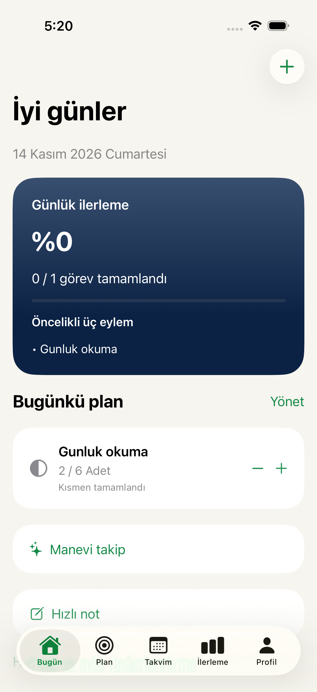
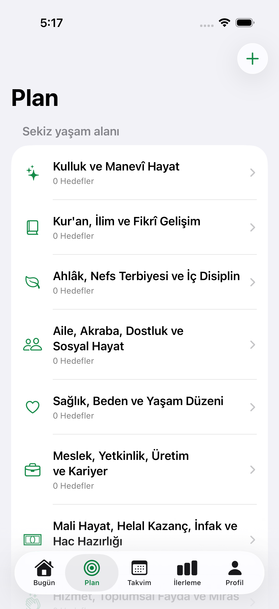
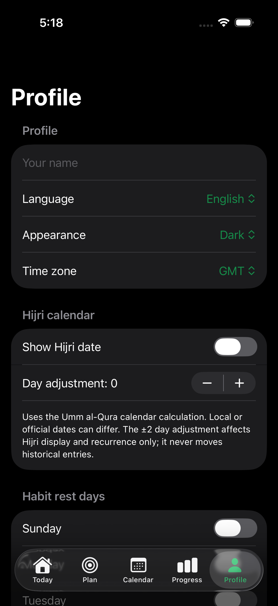
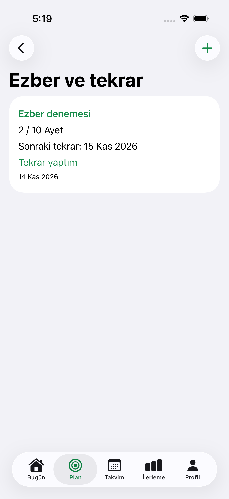

# Gerçek uygulama ekran görüntüleri

XCUITest'in oluşturduğu 12 özgün PNG. Web prototipi veya pazarlama mockup'ı değildir. Test kayıtları gerçek kullanıcı verisinden ayrı memory/UUID store'unda oluşturulmuştur. PNG'lere kırpma, renklendirme, yeniden boyutlandırma veya içerik düzenlemesi uygulanmaz.

Kaynak koşu/commit, test adı ve orijinal byte SHA256 `provenance.json` içinde tutulur. Ölçü: 1206 × 2622, iPhone 17 Pro simülatörü. Bu set, App Store'un her gerekli ekran boyutu ve dil için tam yayın seti olarak onaylanmış değildir.

- Today-TR ve Today-Partial-TR: tamamlanma/2-6 kısmi kayıt ve gerçek günlük oran.
- Plan-TR, Calendar-TR, Progress-TR: yaşam alanları, takvim görevi ve kayıt bazlı grafik.
- Khatm-TR, Memorization-TR, Dhikr-TR, Fasting-TR: gerçek modül kayıtları.
- Profile-Dark-EN, Profile-Light-EN, Today-Light-EN: dil/tema ve boş veri görünümü.

Kaynak dosyalar gerçek UI testinde üretilmiştir. Test sayıları için ../TEST_REPORT.md; kabul/yayın sınırları için ../RELEASE_CHECKLIST.md okuyun.

## Örnek ekranlar

| Bugün | Plan | İngilizce / koyu tema |
|---|---|---|
|  |  |  |

## 16 Kasım ek modül çekimleri

Kaza namazı, haftalık planlama, hedef parçalamanın tarih/gün seçimi ve önerisi ile rutin oluşturucu için beş ek native görüntü ayrı UI akışından alınır. Doğrulanmış son koşunun kanıt bağlantısı TEST_REPORT.md içinde bulunur. Birleşik çevrimdışı galeri `.build-results/MIHEN_Current_Screens_20261116.html`, özgün PNG paketi `.build-results/MIHEN_Current_Screens_20261116.zip` olarak üretilir. Test oturumundaki örnek kayıtlar kişisel geçmiş değildir.

Son ek çekim kanıtı: [43864948660](../evidence/43864948660/provenance.json). Birleşik galeri 21 ekran içerir; beş yeni görüntü 16 Kasım 2026 tarihinde çekilmiştir.
